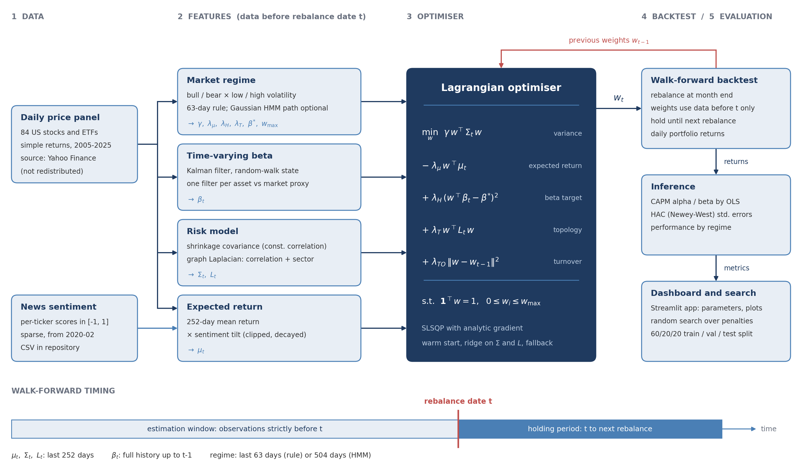
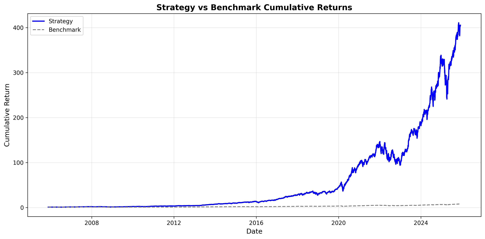
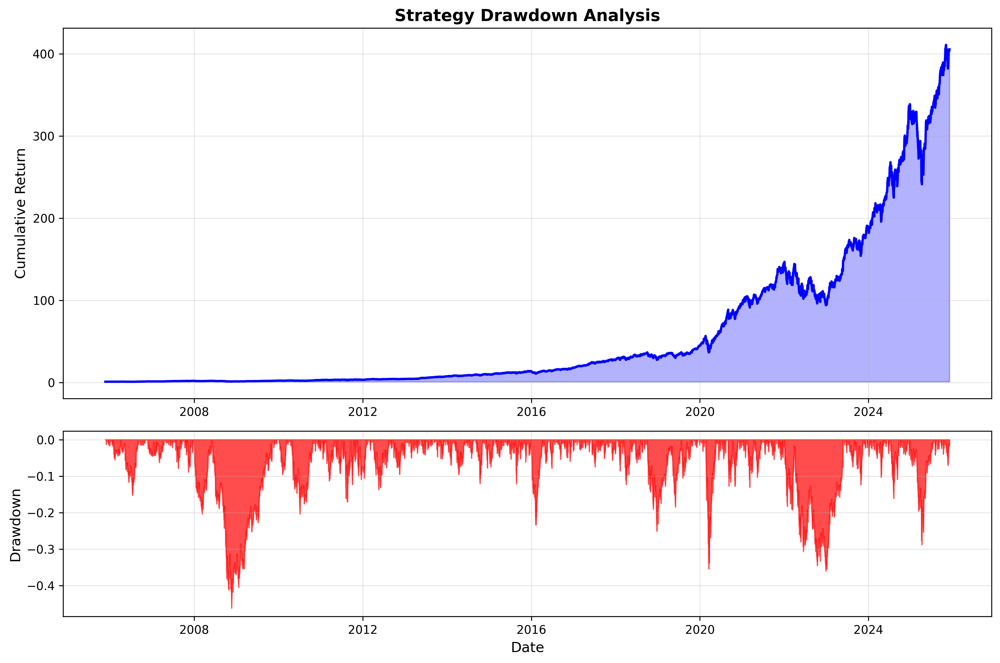
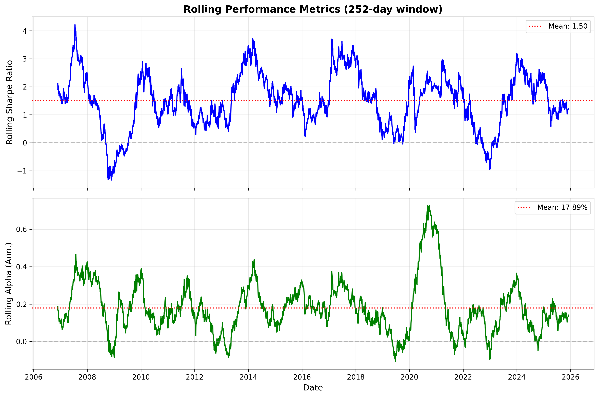

# Lagrangian Portfolio Optimization

Regime-aware penalised mean–variance portfolio optimisation with Kalman time-varying betas, a news-sentiment tilt and a monthly walk-forward backtest, evaluated with HAC (Newey–West) inference.

김재하 (Jaeha Kim) · [github.com/summerjinhere](https://github.com/summerjinhere)



*그림 1. 데이터에서 평가까지의 흐름과 walk-forward 시점 규칙. `src/enhanced_model_v4.py`의 설계를 그린 개념도이며 실행 결과가 아니다.*

## 개요

미국 상장 주식·ETF 84종목의 일별 수익률로 매월 포트폴리오 비중을 정하는 연구용 코드다. 평균-분산 목적함수에 베타 목표, 상관·섹터 구조(그래프 라플라시안), 회전율 penalty를 더하고, 시장 국면에 따라 penalty 가중치와 종목 상한을 바꾼다. 비중은 리밸런싱일 이전 자료만으로 추정하고(walk-forward), 초과성과는 CAPM 회귀의 alpha를 HAC 표준오차로 검정한다.

읽기 전에 현재 상태를 밝혀 둔다.

- 현재 버전은 v4(`src/enhanced_model_v4.py`)다. v4의 백테스트 산출물은 저장소에 커밋돼 있지 않아서 이 문서에는 v4 성과 수치가 없다.
- 커밋된 수치와 그림은 이전 버전(v2)의 결과이고, 전 기간 자료로 한 번 추정한 고정 비중을 같은 기간에 적용한 in-sample 값이다. [결과](#결과)에 출처와 함께 적었다.
- 커밋된 v4 코드에는 HMM 경로 비활성화 등 알려진 문제가 있다. [한계와 다음 단계](#한계와-다음-단계)에 정리했다.

## 방법론

### 최적화 문제

리밸런싱일 $t$, 국면 $r$ 에서 다음 문제를 푼다.

$$
\min_{w}\; f_r(w) = \gamma_r\, w^\top \Sigma_t w \;-\; \lambda_{\mu,r}\, w^\top \mu_t \;+\; \lambda_{H,r}\,(w^\top \beta_t - \beta^{\ast}_r)^2 \;+\; \lambda_{T,r}\, w^\top L_t w \;+\; \lambda_{TO}\,\lVert w - w_{t-1}\rVert_2^2
$$

$$
\text{s.t.}\quad \mathbf{1}^\top w = 1,\qquad 0 \le w_i \le \bar{w}_r
$$

항은 차례로 분산, 기대수익, 포트폴리오 베타와 목표 베타의 차이, 상관·섹터가 가까운 종목 사이의 비중 차이, 직전 비중 대비 변화다. 예산 제약과 비중 상·하한만 hard constraint이고 나머지는 penalty로 목적함수에 들어간다. 가중치 $\gamma$ 와 $\lambda$ 는 풀어서 얻는 승수가 아니라 국면별로 미리 정해 둔 값이다.

제약의 승수를 $\eta$ (예산), $\nu \ge 0$ (하한), $\xi \ge 0$ (상한)로 두면 라그랑지안과 정상성 조건은 다음과 같다.

$$
\mathcal{L}(w,\eta,\nu,\xi) = f_r(w) + \eta\,(\mathbf{1}^\top w - 1) - \nu^\top w + \xi^\top (w - \bar{w}_r \mathbf{1})
$$

$$
2\gamma_r \Sigma_t w - \lambda_{\mu,r}\,\mu_t + 2\lambda_{H,r}\,(w^\top \beta_t - \beta^{\ast}_r)\,\beta_t + 2\lambda_{T,r}\, L_t w + 2\lambda_{TO}\,(w - w_{t-1}) + \eta\,\mathbf{1} - \nu + \xi = 0
$$

여기에 상보성 조건 $\nu_i w_i = 0$, $\xi_i (w_i - \bar{w}_r) = 0$ 이 붙는다. 풀이는 닫힌 해가 아니라 수치해다. `scipy.optimize.minimize`의 SLSQP에 위 식의 해석적 기울기를 넘기고, 직전 비중에서 출발하며(warm start), $\Sigma_t$ 와 $L_t$ 에 작은 ridge를 더한다. 수렴하지 않으면 직전 비중을 제약 범위로 투영해 쓴다. `src/lagrangian_theoretical_framework.py`는 회전율 항이 없는 단일 시점 버전으로, 상·하한에 걸리지 않은 종목의 기울기 평균에서 $\eta$ 를 사후 추정하고 $\lambda$ 에 대한 민감도 분석을 한다.

### 구성 요소

| 요소 | 구현 (`src/enhanced_model_v4.py`) |
|---|---|
| 국면 | 시장 프록시(기본 SPY) 수익률로 강세/약세 × 저/고변동성 4개 국면을 판별한다. Gaussian HMM(`hmmlearn`, 21일 이동 수익률·변동성 표준화, 과거 504일 학습) 경로가 구현돼 있으나, 커밋된 코드에서는 import가 주석 처리돼 있어 최근 63일 평균 수익률의 부호와 연환산 변동성 15% 기준의 규칙만 실행된다. |
| 시변 베타 | 종목별 스칼라 Kalman filter. 상태식 $\beta_t = \beta_{t-1} + \omega_t$, 관측식 $r_{i,t} = \beta_t r_{m,t} + \varepsilon_t$, 잡음 분산 0.001과 0.01, 초기값 1. |
| 기대수익과 감성 | 최근 252일 평균 수익률에 $1 + 0.15 \cdot \mathrm{clip}(s \cdot 0.9^{d}, \pm 0.5)$ 를 곱한다. $s$ 는 가장 최근 감성 점수, $d$ 는 그 뒤 지난 일수다. |
| 위험 모형 | 상수상관 타깃으로 축소한 공분산(축소 강도는 Ledoit–Wolf 추정식을 단순화한 식). $L_t = D - A$ 는 양의 상관계수에 같은 섹터면 0.3을 더한 인접행렬 $A$ 의 라플라시안이다. 기본 섹터 맵에는 10개 티커만 들어 있다. |
| Walk-forward | 매월 마지막 거래일에 리밸런싱한다. 그날 이전 관측치만으로 추정하고 다음 리밸런싱 전까지 비중을 고정한다. 과거 자료가 63일 미만이면 동일가중을 유지한다. |
| 추론 | 무위험수익률 연 2%를 뺀 초과수익률의 CAPM 회귀를 `statsmodels` OLS로 추정하고 HAC(Newey–West) 표준오차를 쓴다. 시차 수는 $\lfloor 4 (T/100)^{2/9} \rfloor$ 로 둔다. v2 코드에는 block bootstrap(블록 22일, 1,000회) 신뢰구간도 있다. |
| 파라미터 탐색 | $\gamma$, $\lambda_H$, $\lambda_T$, $\lambda_{TO}$ 를 무작위 추출하고, 표본을 60/20/20으로 나눠 검증 구간 Sharpe(최대 낙폭 상한 조건)로 고른 뒤 테스트 구간 지표를 따로 보고한다. |

국면별 가중치는 추정값이 아니라 코드에 손으로 넣은 값이다. $\lambda_{TO}$ 의 기본값은 국면과 무관하게 0.1이다.

| 국면 | $\gamma$ | $\lambda_\mu$ | $\lambda_H$ | $\lambda_T$ | $\beta^{\ast}$ | $\bar{w}$ |
|---|---|---|---|---|---|---|
| 저변동성 강세 | 1.5 | 1.5 | 0.3 | 0.05 | 1.1 | 20% |
| 고변동성 강세 | 2.5 | 1.0 | 0.6 | 0.15 | 1.0 | 15% |
| 저변동성 약세 | 3.0 | 0.5 | 0.8 | 0.20 | 0.8 | 12% |
| 고변동성 약세 | 4.0 | 0.3 | 1.2 | 0.30 | 0.6 | 10% |

## 저장소 구조

| 파일 (`src/`) | 구분 | 내용 |
|---|---|---|
| `enhanced_model_v4.py` | 현재 | 국면, Kalman 베타, 감성, 위험 모형, 최적화기, walk-forward 백테스트, 파라미터 탐색 |
| `dashboard_v4.py` | 현재 | v4를 실행하고 결과를 보여 주는 Streamlit 대시보드 |
| `lagrangian_theoretical_framework.py` | 이론 모듈 | 단일 시점 최적화기, KKT 조건, 승수 추정, 민감도 분석, PSR. 단독 실행하면 합성 데이터로 데모가 돈다. |
| `simplified_model_v3.py` | 이전 (v3) | 국면·라플라시안 항이 없는 첫 walk-forward 버전 |
| `enhanced_integrated_model_v2.py` | 이전 (v2) | Kalman 베타, GARCH-MIDAS, 감성, 고정 비중 백테스트, HAC·bootstrap 검증. 베타와 GARCH-MIDAS는 계산만 하고 최적화에는 쓰지 않는다. |
| `integrated_pipeline.py`, `run_analysis.py`, `validate_v2_model.py` | 이전 (v2) | v2 파이프라인 실행과 보고서 생성. 횡단면·십분위 단계는 빈 stub이라 항상 고정 비중 백테스트로 넘어간다. |
| `academic_analysis.py` | 이전 (v2) | Newey–West, 부분기간·rolling 분석, 그림 3종과 LaTeX 생성 |
| `research_report.txt`, `academic_report.tex`, `*.png` | 산출물 | v2 파이프라인이 만든 결과물 |
| `real_sentiment_data.csv` | 데이터 | 감성 점수 ([데이터](#데이터) 참고) |
| `fix_indent.py` | 기타 | v4 파일의 들여쓰기를 고치던 일회성 스크립트. 모델과 무관하다. |

버전별 변경 내용은 [CHANGELOG.md](CHANGELOG.md)에 있다.

## 실행 방법

가격 패널은 저장소에 없으므로 먼저 [데이터](#데이터)의 방법으로 만들어야 한다. 스크립트는 작업 디렉터리에서 두 CSV를 찾으므로 `src/` 안에서 실행한다.

```bash
pip install -r requirements.txt plotly    # 대시보드가 plotly를 쓰는데 requirements.txt에는 빠져 있다
cd src
python lagrangian_theoretical_framework.py   # 데이터 없이 합성 데이터로 최적화기만 확인
python enhanced_model_v4.py                  # v4 walk-forward 백테스트, 수익률·Sharpe·낙폭을 콘솔에 출력
streamlit run dashboard_v4.py                # v4 대시보드 (아래 알려진 문제 1 참고)
python run_analysis.py --mode full           # v2 파이프라인. 커밋된 보고서와 그림 3종을 덮어쓴다
```

## 결과

커밋된 결과는 v2 파이프라인의 것뿐이다. 전략은 84종목의 2005-11-22~2025-12-03 전 기간 평균 수익률과 공분산으로 평균-분산 비중을 한 번 구해(종목당 상한 15%) 같은 기간에 고정 비중으로 적용한 것이고, 벤치마크는 SPY다.

| 지표 | v2 고정 비중 (in-sample) | SPY |
|---|---|---|
| 연환산 수익률 (CAGR) | 35.03% | 10.89% |
| 연환산 변동성 | 25.52% | 19.37% |
| Sharpe (무위험수익률 0) | 1.305 | 0.630 |
| 최대 낙폭 | -46.12% | -55.19% |

출처는 `src/academic_report.tex` 표 위쪽의 성과 행이다. `src/research_report.txt`에는 같은 실행의 CAPM alpha 연 20.25%(HAC t = 6.349), beta 1.083, R² 0.6756, 무위험수익률 연 2% 기준 Sharpe 1.227이 적혀 있다.

이 수치는 전략 성과의 근거가 될 수 없다. 비중을 평가 기간 전체의 자료로 추정했고(look-ahead), 유니버스가 현재 상장 종목의 고정 목록이며, 거래비용을 넣지 않았다. v2 파이프라인이 무엇을 출력하는지 보여 주는 기록으로만 읽어야 한다. 두 보고서의 나머지 값은 인용하지 않았다. `academic_report.tex` 초록의 수치와 표의 Beta·R²는 계산값이 아니라 코드에 고정된 문자열이고, 같은 표의 "Alpha"는 평균 수익률을 연율화한 값이다. `research_report.txt`의 alpha 신뢰구간과 PSR에는 연율화 단위 오류가 있다.



*그림 2. v2 고정 비중 전략(실선)과 SPY(점선)의 누적 수익, 2005-11-22~2025-12-03. `python run_analysis.py --mode full` 실행 시 `academic_analysis.run_comprehensive_analysis()`가 생성한 파일이다. 위에 적은 대로 in-sample 결과다.*

<p>


</p>

*그림 3. 같은 실행에서 나온 낙폭(왼쪽)과 252일 rolling Sharpe·alpha(오른쪽). 그림 2와 같은 수익률 계열로 그린 것이라 같은 한계가 있다.*

## 한계와 다음 단계

알려진 코드 문제 (커밋된 상태를 읽고 확인한 것이며 고치지 않았다)

1. `enhanced_model_v4.py`의 들여쓰기 문제로 HAC 지표 함수 `compute_metrics`가 `EnhancedWalkForwardBacktester` 안쪽에 중첩돼 있다. `dashboard_v4.py`는 모듈 수준 `EnhancedBacktestValidator.compute_metrics`를 호출하므로 지금 상태로는 대시보드가 지표 계산에서 멈춘다. 단독 실행(`python enhanced_model_v4.py`)도 같은 이유로 alpha 검정 없이 기본 지표만 출력한다.
2. `hmmlearn` import가 주석 처리돼 있어 HMM이 아니라 규칙 기반 국면 판별이 쓰인다.
3. `transaction_cost_bps`는 설정값으로만 있고 v3·v4 수익률에서 차감되지 않는다.
4. 국면 판별을 켜면 $\gamma$, $\lambda_H$, $\lambda_T$ 가 국면 표의 값으로 대체되므로 파라미터 탐색은 사실상 $\lambda_{TO}$ 에만 작용한다.
5. 감성 점수는 리밸런싱 당일 값까지 쓰는데 보유 수익률도 당일부터 계산하므로 하루의 시점 겹침이 있다.

방법론의 한계와 다음 단계

- v4 walk-forward 결과를 난수 시드와 설정을 고정해 다시 만들고, 산출물과 재현 명령을 커밋한다. 지금은 v4 성과를 뒷받침하는 파일이 없다.
- 유니버스가 현재 상장 종목 84개의 고정 목록이라 생존 편향이 있다. 시점별 구성 종목으로 바꿔야 한다.
- 회전율에 비례한 거래비용을 수익률에서 차감하고, 비용 수준별 민감도를 본다.
- 국면별 가중치를 손으로 정하지 않고 검증 구간에서 추정하며, 공분산 축소 강도를 Ledoit–Wolf 추정식으로 바꾼다.
- 감성 점수는 하루 늦춰 쓰고, 표본이 얇은 2020년 이전 구간과 분리해 효과를 따로 검정한다.

## 데이터

**가격 패널 (`src/real_backtest_panel.csv`, 미포함).** Yahoo Finance 일별 가격을 `yfinance`로 받은 파일인데, Yahoo Finance 약관이 재배포를 허용하지 않아 저장소에서 뺐다. 코드는 `Date` 인덱스와 종목별 `<TICKER>_price`, `<TICKER>_ret`(단순 수익률) 열을 기대한다. 종목 목록은 감성 CSV의 열 이름과 같다. 아래는 그 형식에 맞춘 예시이며, 원래 패널과 수치가 완전히 같다는 보장은 없다.

```python
import pandas as pd, yfinance as yf

cols = pd.read_csv("src/real_sentiment_data.csv", nrows=0).columns
tickers = [c for c in cols if c not in ("Date", "MARKET_SENTIMENT")]
px = yf.download(tickers, start="2005-11-21", end="2025-12-04", auto_adjust=True)["Close"]
px = px.ffill().bfill()   # 코드가 결측을 처리하지 않으므로 상장 이전 구간은 첫 가격으로 채운다 (수익률 0)
panel = px.add_suffix("_price").join(px.pct_change().add_suffix("_ret")).iloc[1:]
panel.rename_axis("Date").to_csv("src/real_backtest_panel.csv")
```

**감성 점수 (`src/real_sentiment_data.csv`, 포함).** 종목별 -1~1 범위 점수와 `MARKET_SENTIMENT` 열로 된 CSV다. 코드 주석은 FinBERT 뉴스 감성이라고 적고 있으나, 수집·채점 스크립트가 저장소에 없어 출처와 생성 과정을 이 저장소만으로는 재현할 수 없다. 날짜는 2020-02-12~2025-12-03 사이 504개이고 2025년에 240개가 몰려 있다. 종목 열에서 값이 있는 칸은 약 15%이고 그중 약 48%가 0이다. 종목별 편차도 커서 NVDA와 AMZN은 2개 날짜, LQD는 253개 날짜에만 값이 있다. 2020년 이전 구간에서는 감성 조정이 작동하지 않는다.
